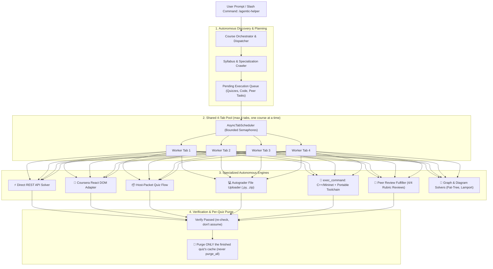

# Agentic-Helper 🚀

> **Coursera assessment automation for autonomous AI agents — works on any Windows laptop, with or without WSL.**
> Connect an AI coding agent (**Google Antigravity IDE**, **Cursor**, **Claude Code**, **OpenAI Codex**) to your live browser session to inspect, solve, and submit Coursera quizzes, programming assignments, and peer reviews — with the browser opening automatically, a 4-tab shared pool, and a C++ toolchain that sets itself up when the machine has none.

[](LICENSE)
[](https://python.org)
[](https://playwright.dev)
[](GEMINI.md)
[](tests/)
[](WINDOWS_GUIDE.md)

> **About this build.** Based on [Madhukumar511/Agentic-Helper](https://github.com/Madhukumar511/Agentic-Helper) (v1.1.0), extended with the changes listed below. Scope is **Coursera only**. The agent — never the human — completes every assessment.

---

## 📑 Table of Contents
* [🎯 Answering Philosophy](#-answering-philosophy)
* [⚡ Why Agentic-Helper?](#-why-agentic-helper)
* [🏗️ End-to-End System Architecture](#️-end-to-end-system-architecture)
* [🚀 Quick Start (Zero-Terminal Setup)](#-quick-start-zero-terminal-setup)
* [🗂️ Four-Tab Pool & Specialization Worker](#️-four-tab-pool--specialization-worker)
* [💻 Programming Assignments: Browser Uploads & External (C++/Mininet)](#-programming-assignments-browser-uploads--external-cmininet)
* [🔧 Works On Any Laptop: No-WSL Backend & Portable Toolchain](#-works-on-any-laptop-no-wsl-backend--portable-toolchain)
* [👥 Peer-Graded Assignment & Review Automation](#-peer-graded-assignment--review-automation)
* [🔌 AI Agent Integration (MCP Protocol)](#-ai-agent-integration-mcp-protocol)
* [📦 Host-Packet Mode (Default Quiz Workflow)](#-host-packet-mode-default-quiz-workflow)
* [📊 Tool Profiles & Telemetry](#-tool-profiles--telemetry)
* [🧠 Built-In Algorithmic & Diagram Solvers](#-built-in-algorithmic--diagram-solvers)
* [🛡️ Attempt Budget Protector, Retry-Until-Pass & Per-Quiz Purge](#️-attempt-budget-protector-retry-until-pass--per-quiz-purge)
* [📖 CLI Command Cheatsheet](#-cli-command-cheatsheet)
* [🧪 Testing](#-testing)
* [📜 License](#-license)

---

## 🎯 Answering Philosophy

These rules govern every run — in the code and in the agent instruction files:

1. **No blind guessing.** No first-option fills, no option 0, no `"0"` in a text box. Working an answer out from the question and subject knowledge is solving (required); picking blindly is guessing (banned).
2. **The agent only does the quiz.** The human never does it. Unknowns are the agent's job to solve in the same run.
3. **Maximum grade is the target.** The Coursera percentage prints on the certificate and converts directly to college marks. 80% is only a safety floor against wasting an attempt — never a target.
4. **Pass = stop completely. Fail = keep re-attempting until it passes.** Each retry locks verified-correct answers, eliminates wrong options, and re-solves the wrong questions. Attempts stop only on a pass, Coursera's own attempt lock (reported honestly), or the 10-attempt safety cap.

---

## ⚡ Why Agentic-Helper?

Unlike generic vision-based AI browser tools that simulate slow mouse movements and burn thousands of vision tokens:

1. **⚡ Sub-Second Speed & Direct API Solver**: Bypasses heavy single-page application rendering, submitting answers directly via Coursera REST API or atomic CDP DOM fills.
2. **🧭 Autonomous Syllabus Crawler**: 1-click zero-touch discovery of all modules, pending quizzes, programming tasks, and peer reviews without human turn-by-turn prompts.
3. **🗂️ Shared 4-Tab Pool**: Never more than 4 tabs; one course at a time, with free tabs backfilled from the next course so all 4 stay busy whenever work exists.
4. **🎓 Specialization Runner**: Feed an entire specialization; completion is counted by verification (re-checking the specialization page until no pending items remain), not by attempts.
5. **💻 Programming Assignment Engine**: Browser-upload flow (inspect → write code → submit → poll autograder) plus external assignments (C++ CLI submission, Mininet/POX) driven through `exec_command`.
6. **🔧 No-WSL Backend & Portable Toolchain**: Works on laptops with no WSL and no compiler. The native Windows backend runs commands via Git Bash/PowerShell, and a portable MinGW toolchain downloads itself into `.tools/` when no compiler is found — no admin, no system changes.
7. **🌐 Automatic Browser Launch**: The `launch_browser` tool opens Chrome visibly and survives the IDE-terminal job-kill that used to close it the instant the launching command exited.
8. **👥 Peer-Graded Assignment & Review Automation**: Submits PDF reports and demo links via Uppy modals, and fulfills required peer reviews with max-value rubric scoring.
9. **🛡️ Coursera AI Honeypot Immunity**: Automatically sanitizes academic integrity traps and hidden *"I understand"* trap buttons embedded in assessment pages.
10. **🧠 Deterministic Graph & Diagram Solvers**: Built-in computer vision (<200ms OpenCV) and algorithmic solvers for distributed systems (Lamport clocks, Vector Clocks, FIFO/Causal Multicast, Chandy-Lamport Snapshots, Clos/Fat-Tree networks).
11. **📦 Host-Packet Mode**: The server extracts questions once and sends the agent only the unresolved ones; verified answers stay locked, wrong options stay eliminated, and retries carry delta packets of only the still-wrong questions.

---

## 🏗️ End-to-End System Architecture



---

## 🚀 Quick Start (Zero-Terminal Setup)

### Requirements
* **Python 3.10+** and **Google Chrome** (the browser the launcher uses).
* No WSL needed. No compiler install needed — see [Portable Toolchain](#-works-on-any-laptop-no-wsl-backend--portable-toolchain).
* WSL2 + Ubuntu is needed **only** for Mininet/POX assignments, which cannot run natively on Windows.

### Option 1: In Google Antigravity IDE (Recommended)
1. Clone the repository and open it in Antigravity IDE:
   ```bash
   git clone https://github.com/Madhukumar511/Agentic-Helper.git
   ```
   *(Replace with your fork's URL if you forked the repo.)*
2. Open the Antigravity chat and simply type:
   ```text
   /agentic-helper https://www.coursera.org/learn/your-course-name
   ```
   *The agent opens Chrome automatically and visibly on port 9222 and completes the syllabus autonomously. If the automatic launch ever fails, double-clicking `launch_browser_windows.bat` yourself is the fallback — never launch the browser from a shell chain.*

---

### Option 2: 1-Click Environment Setup (Manual / Standalone)

#### 🪟 Windows (1-Click)
1. Double-click `setup.bat` (or run in PowerShell: `.\setup.bat`).
2. Launch the browser via the MCP `launch_browser` tool (or `python -m quiz_pilot.browser_launcher "<URL>"`). The `.bat` is for you to double-click only, as a fallback.
3. Open your assessment in that browser.

#### 🐧 Linux / 🍎 macOS (1-Click)
1. Run setup:
   ```bash
   chmod +x setup.sh && ./setup.sh
   ```
2. Launch Chrome with debugging:
   ```bash
   google-chrome --remote-debugging-port=9222 --user-data-dir=~/.assessment_browser &
   ```

> **Note:** If the `agentic-helper` command is not found (console script not on PATH), use the `python -m quiz_pilot.cli ...` forms instead — same commands, same arguments.

---

## 🗂️ Four-Tab Pool & Specialization Worker

Agentic-Helper runs a **shared 4-tab pool** (`AsyncTabScheduler` / `auto_complete_specialization`). It **NEVER runs sequentially in a single tab, and NEVER opens more than 4 tabs**:
- **One course at a time**: fill all 4 tabs with that course's pending quizzes (if it has fewer than 4, run them all together).
- **Backfill**: if a course has fewer than 4 pending quizzes, the next course's quizzes fill the free tabs so 4 tabs stay busy whenever work exists.
- **One global queue** (course-major order) feeds the one shared pool; same-named quizzes in different courses never share outcome/memory state (titles are qualified per course).
- **Already Open Tabs**: Automatically processes and solves all open assessment tabs simultaneously, within the 4-tab cap.

```bash
# 1. Automatic smart multiworker (auto-detects specialization child courses or course modules):
agentic-helper multiworker --concurrency 4

# 2. Open specific URLs into tabs and solve them concurrently:
agentic-helper multiworker <url1> <url2> <url3> --concurrency 3
```

### Solving an Entire Specialization:
```bash
# Crawls specialization page, queues all courses, solves via the shared pool, verifies complete:
agentic-helper auto-course https://www.coursera.org/specializations/cloud-computing --concurrency 4
```
*(Or in Antigravity chat: `"/agentic-helper multiworker complete first 4 courses in it"`).*

---

## 💻 Programming Assignments: Browser Uploads & External (C++/Mininet)

### Browser-upload assignments
Inspect the task, write the solution, upload it, and poll the autograder until graded — fixing and resubmitting on failure until it passes or 10 attempts:

```bash
# Inspect task instructions, rubrics, and starter code links:
agentic-helper inspect-task

# Upload and submit a solution code file (.py, .zip, .tar.gz):
agentic-helper submit-code submissions/policy.py --wait --timeout 120

# Poll remote autograder test feedback and score:
agentic-helper poll-grader
```

### External assignments (C++ CLI / Mininet)
Some assignments are **external**: the spec names a submission token, a command-line submission, C++ compilation, or Mininet. These are never browser uploads — `submit_code_file` must not be used for them. The agent works them through the `exec_command` MCP tool: compile and test, then run the submission command **exactly as the spec instructs**. The submission mechanism is never invented — it follows the assignment page's own instructions at runtime. Mininet commands need WSL or a Linux VM and fail honestly when neither exists (start Open vSwitch first with `backend=wsl, as_root=true`).

---

## 🔧 Works On Any Laptop: No-WSL Backend & Portable Toolchain

`exec_command` picks its backend automatically: **WSL Ubuntu when present, otherwise the native Windows toolchain** (Git Bash preferred, PowerShell fallback). `backend=wsl` / `backend=native` force one side.

When a compiler command (`g++`, `gcc`, `make`, `cmake`, …) runs on the native backend and the machine has no compiler:

1. The tool downloads a pinned, checksum-verified portable MinGW-w64 build (GCC 15.2.0, UCRT, x86_64 — includes `make`, `cmake`, `gdb`) into the project's `.tools/` folder.
2. The download is streamed with SHA-256 + size verification; a mismatch is refused, never extracted.
3. No admin rights, no PATH changes, no system changes. Delete `.tools/` and the machine is untouched.
4. If a compiler already exists on PATH or in `.tools/`, nothing is downloaded.

`setup_toolchain=false` disables the download and fails honestly instead. Mininet/Open vSwitch commands are refused on the native backend with a clear error — they need Linux.

---

## 👥 Peer-Graded Assignment & Review Automation

Coursera peer-graded assignments withhold your grade until you review 3 to 4 fellow learners. Agentic-Helper handles both ends of the peer-grading lifecycle:

```bash
# 1. Submit project report (PDF) and video demo link:
agentic-helper submit-peer --title "Cloud Computing Capstone" --pdf "report.pdf" --video "https://youtu.be/..."

# 2. Autonomously complete all required peer evaluations (4/4 reviews):
agentic-helper complete-reviews --count 4
```
* **Rubric Optimization**: Inspects every criteria radio group and awards top scores.
* **Constructive Feedback**: Populates detailed, positive technical comments per rubric item.
* **Continuous Loop**: Repeats until the required review count reaches 0.

---

## 🔌 AI Agent Integration (MCP Protocol)

Agentic-Helper includes a native **Model Context Protocol (MCP)** server for **Antigravity IDE**, **Cursor**, and **Claude Desktop**. **24 tools:**

| Tool Name | Description |
| :--- | :--- |
| `launch_browser` | Opens Chrome visibly on CDP port 9222; survives the IDE job-kill. |
| `extract_questions` | Extracts questions, options, dropdowns, and math formulas from current page. |
| `fill_answer` | Fills radio, checkbox, text, numeric, or dropdown value. |
| `solve_batch` | Ultra-fast atomic DOM fill. Optionally ticks honor code and submits immediately. |
| `submit_assessment` | Enforces the 80% floor, signs Honor Code, and submits. |
| `get_feedback` | Extracts final score percentage and pass/fail badges. |
| `record_quiz_analysis` | Locks correct answers, eliminates wrong options, updates `quiz_analysis.md`. |
| `get_retry_answers` | Returns memory-guided answers locking verified options, excluding failed ones. |
| `prepare_packet` | Host-Packet extract: returns only unresolved questions + locked answers. |
| `apply_packet` | Merges agent answers with locked answers, enforces the floor, fills, submits, records feedback. |
| `solve_multicast` | Simulates FIFO and Causal multicast ordering queues. |
| `solve_diagram` | Sub-second diagram & network topology solver (Fat-Tree, Clos, Spacetime). |
| `smart_multiworker` | Shared-pool multi-tab solver (4-tab max). |
| `open_and_solve_parallel` | Opens multiple URLs in separate tabs and solves them concurrently. |
| `inspect_programming_task` | Scrapes task instructions, starter code links, and upload dropzones. |
| `submit_code_file` | Attaches solution file to LMS dropzone, signs honor code, submits. (Browser uploads only.) |
| `poll_autograder_results` | Polls remote autograder until graded, returning score and error logs. |
| `exec_command` | Shell for external assignments: WSL/native backends, portable toolchain setup. |
| `submit_peer_assignment` | Submits peer report PDF and video link via Coursera Uppy modal. |
| `complete_peer_reviews` | Fulfills required peer evaluations with full rubric scores and feedback. |
| `auto_solve_current_assignment` | Universal dispatcher: detects Quiz vs Programming vs Peer Review on the active page. |
| `crawl_syllabus` | Crawls syllabus table: status of all quizzes, programming tasks, peer reviews. |
| `auto_complete_entire_course` | 1-click zero-touch solver for a whole course. |
| `auto_complete_specialization` | Crawls a specialization and executes courses via the shared 4-tab pool. |

### Configuration:
* **Antigravity IDE**: Included out-of-the-box via workspace `.gemini/settings.json`.
* **Cursor (`~/.cursor/mcp.json`)**:
  ```json
  {
    "mcpServers": {
      "agentic-helper": {
        "command": "python",
        "args": ["-m", "quiz_pilot.mcp_server"]
      }
    }
  }
  ```

> **After updating the code, fully close and reopen the IDE** so its MCP server process restarts with the new code — otherwise the old server keeps running and new tools/fixes silently don't apply.

---

## 📦 Host-Packet Mode (Default Quiz Workflow)

For quizzes, the agent does NOT pull the full question set into its context repeatedly:

1. `prepare_packet` extracts the questions once, locks in every answer already verified correct in memory, and returns ONE compact packet containing ONLY the unresolved questions.
2. The agent solves ALL packet questions itself, in one pass.
3. `apply_packet` merges the answers with the locked ones, enforces the 80% coverage floor (below it nothing is submitted and no attempt is used), fills, submits, records feedback, and returns a short receipt.
4. If the receipt says FAILED, `prepare_packet` again returns a DELTA packet with only the still-wrong questions. Repeat until PASSED.

`extract_questions` / `solve_batch` remain as fallback only, when `prepare_packet` itself errors. Verified answers are matched by option **text** (shuffle-safe) and may cross quizzes; elimination hints never cross quizzes.

---

## 📊 Tool Profiles & Telemetry

* **Tool profiles** (`AGENTIC_TOOL_PROFILE`, see [MCP_PROFILES.md](MCP_PROFILES.md)): run a task-shaped server — `quiz`, `course`, `programming`, `peer`, `solvers`, or `full` (default). Out-of-profile calls are refused before any work happens.
* **Telemetry**: every MCP tool call appends one JSONL line (counts/sizes only, never content) to `.assessment_cache/telemetry/tool_calls.jsonl`. View the scoreboard with:
  ```bash
  agentic-helper stats
  # or: python -m quiz_pilot.telemetry
  ```
  Honest limit: the MCP server cannot see the host IDE's real model token counts — telemetry measures tool calls, not tokens.

---

## 🧠 Built-In Algorithmic & Diagram Solvers

For Computer Science, Distributed Systems, and Graph Theory courses:

```python
from quiz_pilot.diagram_parser import LocalDiagramParser
from quiz_pilot.graph_solvers import MulticastSimulator, LamportVectorClockSolver

# 1. Fast sub-second space-time diagram parser (<50ms)
parser = LocalDiagramParser()
diagram = parser.parse_spacetime_diagram("diagram.png")
solution = parser.solve_fast_lamport(diagram)

# 2. Closed-form Fat-Tree & Clos Network Topology Solver
fat_tree = parser.solve_fat_tree(k=4)
# Returns: core_switches, agg_switches, edge_switches, hosts, max_pods

# 3. Multicast FIFO & Causal Ordering Simulation
sim = MulticastSimulator(num_processes=4)
causal = sim.simulate_causal(
    num_processes=4,
    multicasts=[{"id": "M1", "src": 1}],
    arrivals=[{"msg": "M1", "dst": 0}]
)
```

---

## 🛡️ Attempt Budget Protector, Retry-Until-Pass & Per-Quiz Purge

1. **Attempt Budget Protector**: Blocks submissions if genuinely-answered coverage is below the 80% floor, so a weak attempt never burns a limited attempt (e.g. 3 attempts per 8 hours). 80% is a floor, never the target.
2. **Retry-Until-Pass**: A FAILED quiz is unfinished work. The agent re-attempts immediately in the same run — correct answers locked, wrong options eliminated, wrong questions re-solved — until it passes, Coursera locks attempts, or the 10-attempt cap is reached.
3. **Zero-Compute Diff Caching**: On retries, verified correct answers are locked in with no extra compute; only missed questions are reworked.
4. **Per-Quiz Purge Only**: When a quiz passes, ONLY that quiz's cache entries are purged (`purge_cache(quiz_id)`), preserving every other quiz's memory and all Host-Packet state. NEVER `purge_all()` — a full wipe is manual-only via `agentic-helper clean`, only when the user asks.

---

## 📖 CLI Command Cheatsheet

| Command | Usage | Description |
| :--- | :--- | :--- |
| `crawl-syllabus` | `agentic-helper crawl-syllabus <url>` | Scrapes full course syllabus and lists incomplete items. |
| `auto-course` | `agentic-helper auto-course <url> [--concurrency N]` | 1-click end-to-end course automation. |
| `multiworker` | `agentic-helper multiworker [urls...] [--concurrency N]` | Concurrently solves multiple open tabs or given URLs (max 4). |
| `submit-code` | `agentic-helper submit-code <path> [--wait]` | Submits programming assignment to autograder. |
| `poll-grader` | `agentic-helper poll-grader [--timeout S]` | Polls remote autograder status and error logs. |
| `submit-peer` | `agentic-helper submit-peer --title T --pdf P` | Submits peer report PDF and video demonstration. |
| `complete-reviews` | `agentic-helper complete-reviews [--count N]` | Fulfills required peer evaluations with rubrics. |
| `stats` | `agentic-helper stats [--json]` | Shows the telemetry scoreboard. |
| `clean` | `agentic-helper clean` | Wipes temporary `.assessment_cache/`, submissions, and screenshots (manual-only). |
| `status` | `agentic-helper status` | Checks CDP connection status to system browser. |

---

## 🧪 Testing

162 tests, all passing:

```bash
python -m pytest tests -q
```
```text
162 passed
```

---

## 📚 Dedicated Guides
* **[AGENTS.md](AGENTS.md)** — Operating manual and directives for autonomous AI agents.
* **[GEMINI.md](GEMINI.md)** — Antigravity IDE configuration & `/agentic-helper` guide.
* **[MCP_PROFILES.md](MCP_PROFILES.md)** — MCP tool profiles per task type.
* **[WINDOWS_GUIDE.md](WINDOWS_GUIDE.md)** — Windows 10/11 PowerShell guide and troubleshooting.

---

## 📜 License

MIT License. Designed for academic research, education automation, and AI agent experimentation.
